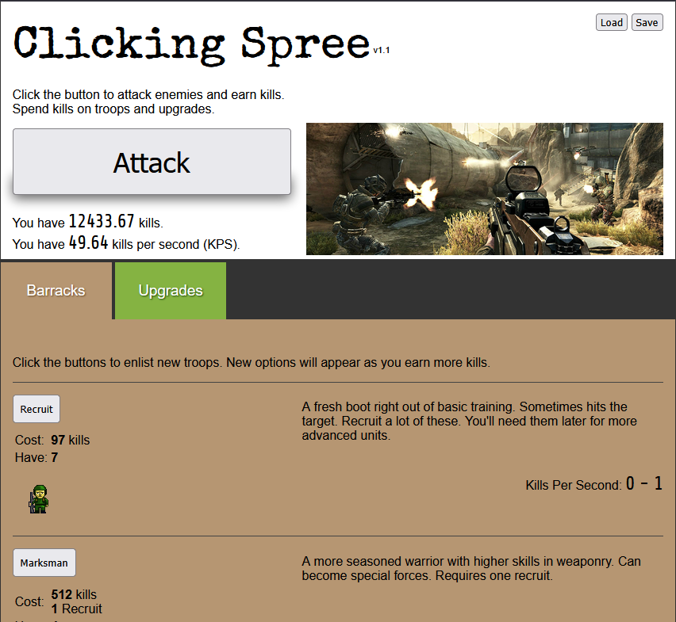

# Clicking-Spree

A little incremental game made in JavaScript.



## Features

- Click or hold **Attack** to earn kills. Holding fires until the magazine is empty, then the rifle reloads. Spend kills on troops and attachments
- 9 units in the Units tab, from Recruits to B-1 Lancer bombers. Combat units earn kills per second, shown under each icon; the HEMET cargo truck earns supplies per second instead
- Advanced units are crewed by cheaper ones: Marksmen need a Recruit, Heavy Armor needs 3 Marksmen, a B-1 needs 4 Spec Ops, and so on
- Unit prices rise 10% with every purchase. Troops produced by buildings do not raise the price. Buy 1 at a time from the start, then 5 at 100 troops, 100 at 1,000 troops, and as many as you can afford after the first boss
- Recruits roll their kills individually each second, so your income has some randomness
- A Weapon tab for the rifle. It starts with a basic barrel, a 30-round magazine, iron sights, and a basic stock, none of which add a bonus. Buy other attachments with kills, then equip, swap, or remove them. Muzzle, underbarrel, and stock add click damage; the barrel shortens the attack cooldown; magazines change how many rounds you fire and how long the reload takes; accessory and sight add crit chance
- Units and attachments are revealed as your kill count grows
- Experience and levels: every kill earned is 1 XP, and each level gives a skill point
- A skill tree with three branches, each with 4 tiers that unlock as you spend points in them:
  - Assault: more kills from clicks and KPS
  - Intel: critical hits, better recruit rolls, and High-Value Targets to click for bonus kills
  - Logistics: cheaper units and attachments, slower price growth, and smaller crews
- Free skill reset at any time
- A world map of 4 zones with 4 levels each: earn the level's kill goal, then beat its boss in a timed fight to unlock the next level. Jungle adds 50 click damage and Iron Frost adds 500 while you are deployed there
- Supplies: the first clear of each level pays a big supply reward, and later levels pay much more
- Cleared levels can be replayed for supplies: each time you reach the kill goal again you collect 10% of the first-clear reward and stay on that level
- Buildings, bought with supplies: one per unit type (Barracks, Firing Range, Supply Depot, up to the Bomber Hangar), each producing its unit for free on a timer that gets faster with every extra building
- Perks, bought with perk points on their own tab. Prestige resets the run (kills, troops, buildings, weapon, skills, supplies, and the map) and pays perk points for every kill threshold that run passed: 1,000,000 pays 1, 5,000,000 pays 2, the next pays 4, and so on. Perks stay. Every unbought perk costs the same, starting at 1 point and doubling after each purchase
- Numbers from 1,000 up can be shown in scientific notation (1.22e4) or with suffixes (12.2K). Two buttons in the header switch between them, and the choice is remembered
- Save your progress in the browser (localStorage), with an autosave every 15 seconds; it loads automatically next time you open the game
- Plain JavaScript (ES modules) with no dependencies; the whole page is built from the unit and attachment data in `data.js`

## How to run

To run the game, you need `http-server` installed, or another way of serving HTML. Opening the file directly in the browser won't work because of the usage of modules.

```
npx http-server
```

Then open the localhost URL it prints.

## Roadmap

- Add more units and upgrades
- Add original artwork

## Changelog

- v1.13 - Buy amounts unlock as you play: 5x at 100 troops, 100x at 1,000, and Max after the first boss. Each unit shows its KPS under the icon. Jungle adds 50 click damage and Iron Frost adds 500 while you are deployed there. Reset confirms beside the button
- v1.12 - Buy units and buildings 1, 5, 100, or as many as you can afford at once. A debug panel can grant kills, supplies, skill points, and perk points
- v1.11 - Perks and prestige. Prestige resets the run and pays perk points for each kill threshold passed (1,000,000 pays 1, then 2, then 4). Twenty perks, bought in any order, persist across prestiges. The header shows power and supplies per second
- v1.9 - Weapon tab replaces the upgrade chain: buy attachments and they equip, with a basic barrel, magazine, iron sights, and stock to start. Attacks have a cooldown and can be held to fire; magazines hold ammo and reload. New unlocks badge their slot. Boss buttons show the fight outlook. Building progress bars fill to the end
- v1.8 - scientific and suffix notation for large numbers, with a header switch that is remembered, and unit prices that count purchases only
- v1.7 - supplies earned by clearing levels, replayable cleared levels with batched clear messages, a Buildings tab where supply-bought buildings produce free units, the HEMET truck (supplies per second) and its Supply Depot, the Barracks tab renamed to Units, and boss HP rebalanced around buildings
- v1.6 - much tougher bosses, power levels for you and each boss (boss estimates are fuzzed), a 20% kill penalty and retreat message when a boss fight times out, a boss timer bar, hidden zones and levels until unlocked, and a subtler Attack button press
- v1.5 - world map with 4 zones of 4 levels each, a header level panel with new-level announcements, lifetime kills for level progress, and timed boss fights to clear each level
- v1.4 - compact unit rows, a Reset button to start a new game, and floating damage numbers for every click (red for crits)
- v1.3 - sticky, slimmer tabs with badges for buyable upgrades and unspent skill points; unlocked tiers drop their requirement text
- v1.2 - experience, levels, and a skill tree (Assault, Intel, Logistics)
- v1.1.1 - refactor the code to be modular
- v1.1 - modernize js, remove jquery
- v1.0 - initial commit
